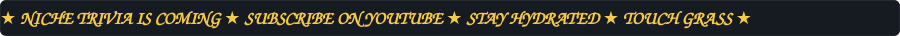
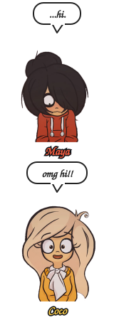
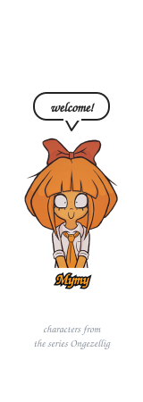
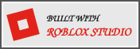
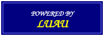
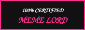

 

<table>
  <tr>
    <td align="center" width="200"> <b>📺 Watch on YouTube</b> @noproblemrr</td>
    <td align="center" width="200"> <b>🎧 Vibe on Spotify</b> my current rotation</td>
  </tr>
</table>

 

<table>
  <tr><th colspan="2">📋 Quick Facts</th></tr>
  <tr><td><b>Main quest</b></td><td>Building Niche Trivia on Roblox</td></tr>
  <tr><td><b>Weapon of choice</b></td><td>Luau, TypeScript, and a lot of thai tea</td></tr>
  <tr><td><b>Side quests</b></td><td>FTC robotics, obsidian plugins, and youtube</td></tr>
  <tr><td><b>Fuel</b></td><td>Music, memes, and questionable snacks</td></tr>
</table>

 

 

<table>
  <tr>
    <th>Game</th>
    <th>Level</th>
    <th>What is it?</th>
    <th>Meme rating</th>
  </tr>
  <tr>
    <td>🎮 <b>Niche Trivia</b></td>
    <td>🚧 Under construction</td>
    <td>A Roblox trivia game for people who know a little too much about their favorite topics</td>
    <td>🧠🤓☝️ 9/10 "erm, actually..."</td>
  </tr>
  <tr>
    <td>🔄 <b><a href="https://github.com/noproblemerr-web/live-room-sync">live-room-sync</a></b></td>
    <td>⚙️ Tinkering</td>
    <td>An Obsidian plugin: live, serverless vault sync and Google-Docs-style typing with a room code</td>
    <td>🤯⚡🔥 8/10 "wait, it syncs live?!"</td>
  </tr>
  <tr>
    <td>🤖 <b><a href="https://github.com/noproblemerr-web/autopathing-ftc">autopathing-ftc</a></b></td>
    <td>🛠️ Tinkering</td>
    <td>A click-to-path autonomous planner for FTC robots: draw a path, export a ready-to-run Java OpMode</td>
    <td>🤖🗿💯 10/10 "robot go brrr"</td>
  </tr>
  <tr>
    <td>🏔️ <b><a href="https://github.com/noproblemerr-web/everest-journey">everest-journey</a></b></td>
    <td>🧗 Climbing</td>
    <td>My Everest journey and sponsorship opportunity</td>
    <td>🥶🏔️😤 11/10 "touch snow, not grass"</td>
  </tr>
</table>

 

 

