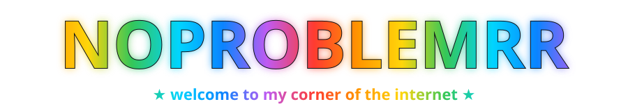
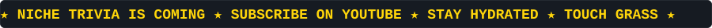
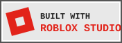
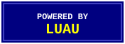
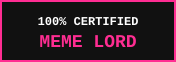

 

 

<table>
  <tr>
    <td align="center" width="260"> <b>📺 Watch on YouTube</b> @noproblemrr</td>
    <td align="center" width="260"> <b>🎧 Vibe on Spotify</b> my current rotation</td>
  </tr>
</table>

 

<table>
  <tr><th colspan="2">📋 Quick Facts</th></tr>
  <tr><td><b>Main quest</b></td><td>Building Niche Trivia on Roblox</td></tr>
  <tr><td><b>Weapon of choice</b></td><td>Luau + Roblox Studio</td></tr>
  <tr><td><b>Side quest</b></td><td>Making videos on YouTube</td></tr>
  <tr><td><b>Fuel</b></td><td>Music, memes, and questionable snacks</td></tr>
</table>

 

 

<table>
  <tr>
    <th>Game</th>
    <th>Level</th>
    <th>What is it?</th>
    <th>Meme rating</th>
  </tr>
  <tr>
    <td>🎮 <b>Niche Trivia</b></td>
    <td>🚧 Under construction</td>
    <td>A Roblox trivia game for people who know a little too much about their favorite topics</td>
    <td>🧠🤓☝️ 9/10 "erm, actually..."</td>
  </tr>
  <tr>
    <td>🗿 <b>Mystery project</b></td>
    <td>🔒 Locked</td>
    <td>Next one is still cooking. Stay tuned</td>
    <td>🍳👀💀 ???/10 "no comment"</td>
  </tr>
</table>

 

 

